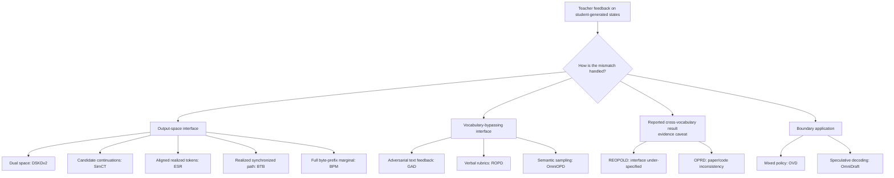

# Awesome Cross-Tokenizer On-Policy Distillation

> A curated, evidence-backed research map of on-policy distillation across different tokenizers and vocabularies.

[日本語](README_ja.md) · [Machine-readable data](data/papers.yml) · [BibTeX](references.bib)

On-policy distillation (OPD) trains a student with teacher feedback on the
student's own generated trajectories. Standard token-level OPD assumes that
teacher and student distributions share coordinates. That assumption breaks
when their tokenizers or vocabularies differ: token IDs, token boundaries, and
sometimes even the available byte strings no longer correspond.

This list focuses on the interfaces proposed to cross that boundary. It is not
another general OPD bibliography. Every entry is labeled by trajectory source,
comparison interface, supervision coverage, teacher access, probability
semantics, tested model pair, and code availability.

## Scope and selection policy

The snapshot date is **2026-08-15**. “Verified” below means that the stated
claim was checked against public full text; it does **not** mean that we
independently reproduced the experiments.

A work is included in the **core** map when it has:

1. a public English paper or preprint;
2. teacher supervision on student-generated rollouts or student-visited states;
3. an explicit teacher–student tokenizer/vocabulary mismatch;
4. a concrete interface for passing supervision across that mismatch; and
5. a reported training experiment with a mismatched pair.

We separate papers that only report a cross-vocabulary experiment without
documenting the interface, boundary applications such as speculative decoding,
software/resources, and mostly off-policy enabling work. A different model
family is **not** by itself evidence of a different tokenizer.

Throughout this README, model pairs use **Teacher → Student** order, even when a
paper uses the opposite convention.

## Research map

### Start here

Three papers expose the central output-space trade-off especially clearly:

- **[SimCT](https://arxiv.org/abs/2605.07711)** constructs a finite set of
  jointly realizable continuations, recovering more local alternatives than
  exact shared-token matching.
- **[BTB](https://arxiv.org/abs/2606.09456)** synchronizes the realized teacher
  and student token paths and transfers a scalar path-level signal.
- **[BPM](https://arxiv.org/abs/2607.22334)** routes the full teacher next-token
  mass into student byte-prefix events plus a residual category.

They should not be read as interchangeable “token alignment” methods: their
comparison events and the amount of teacher distribution they expose are
different.

## Core methods

### Output-space interfaces

| Work | Public status | Cross-tokenizer interface | Feedback coverage | Teacher access | Probability semantics | Representative verified pair · code |
|---|---|---|---|---|---|---|
| [DSKD / DSKDv2](https://arxiv.org/abs/2504.11426) (2025) | arXiv v1; under review | Project teacher/student hidden states into the other's representation space, reuse the corresponding LM head, and retain exactly aligned positions with ETA | Dense distributions at retained positions, in both model output spaces | Hidden states and LM heads | Comparable head-space distributions; not a string-probability transport | Qwen2-1.5B → GPT2-120M; Mistral-7B → TinyLLaMA-1.1B · [code](https://github.com/songmzhang/DSKDv2) |
| [SimCT](https://arxiv.org/abs/2605.07711) (2026) | arXiv v2 | Shared surface tokens plus minimal multi-token continuations realizable by both tokenizers | A finite, locally constructed candidate set | White-box next-token scores | Candidate-normalized continuation scores; not a full teacher-induced marginal | Qwen2.5-7B-Instruct → Phi-4-mini-Instruct / Gemma-2-2B-IT; Phi-4-mini-Instruct → Gemma-2-2B-IT · [code](https://github.com/sunjie279/SimCT-) |
| [ESR](https://arxiv.org/abs/2605.27028) (2026) | arXiv v1 | Decode the early student rollout, retokenize it for the teacher, then greedily match text spans and apply reverse KL on aligned tokens | Greedily aligned tokens in an early rollout window | White-box token log-probabilities | Partial aligned-token objective; no full mapped distribution is characterized | Qwen3-4B → Gemma-2-2B (cross-family), plus cross-generation Qwen/Gemma pairs · code not found |
| [BTB](https://arxiv.org/abs/2606.09456) (2026) | arXiv v1 | Dual pointers form minimal decoded-string synchronization chunks; teacher/student canonical-path likelihoods provide chunk credit | The realized student path | Per-token teacher log-probabilities on the realized text | Path likelihood/credit, not a counterfactual full-vocabulary target | Qwen3-8B → Llama-3.1-8B-SFT; DeepSeek-R1 → DeepSeek-R1-Distill-Qwen-7B · [code](https://github.com/ivanniu/On-Policy-Distill) |
| [BPM](https://arxiv.org/abs/2607.22334) (2026) | arXiv v1 | Route each teacher token to the longest student-token byte prefix; aggregate collisions and retain unmatched mass in a residual category | Full student vocabulary plus residual | Full teacher next-token distribution | Mass-preserving; exact byte-prefix marginal at >99% of reported positions, chain-factorized lower bound otherwise | Qwen3-32B / GLM-Z1-9B-0414 / MiniMax-M2.7 → Qwen3.5-2B · [project](https://bpm-opd.github.io/), code announced but not available at snapshot |

### Vocabulary-bypassing interfaces

These methods avoid directly mapping teacher token probabilities into the
student vocabulary.

| Work | Public status | Interface | Feedback coverage | Teacher access | Representative verified pair · code |
|---|---|---|---|---|---|
| [GAD](https://arxiv.org/abs/2511.10643) (2025) | arXiv v3 | A co-evolving discriminator distinguishes fixed teacher responses from current student responses and supplies the student's RL reward | Sequence-level score on current student rollouts | Pre-collected teacher text only | GPT-5-Chat → Qwen2.5-3B/7B/14B-Instruct or Llama-3.x-Instruct · [code](https://github.com/microsoft/LMOps/tree/main/gad) |
| [ROPD](https://arxiv.org/abs/2605.07396) (2026) | arXiv v1 | A rubricator contrasts teacher and current student answers to induce prompt-specific textual criteria; a verifier scores student rollouts against them | Weighted rubric-item pass rate per rollout | Text-only teacher/rubricator/verifier | GPT-5.2-Chat → Qwen3-4B / Gemma-3-4B-IT; Qwen3-30B-A3B → Qwen3-4B · [code](https://github.com/Peregrine123/ROPD_official) |
| [OmniOPD](https://arxiv.org/abs/2606.01476) (2026) | arXiv v2 | Monte Carlo teacher continuations scored by semantic similarity over decoded chunks | Selected high-entropy chunks on student trajectories | Text generation only; supports black-box/API teachers | Qwen3-32B, Claude-4.5-Haiku, or Gemini-2.5-Flash supervising student reasoning · code not found |

### Reported cross-vocabulary results with evidence caveats

| Work | What the paper reports | Why it is not in the core interface table |
|---|---|---|
| [REOPOLD](https://openreview.net/forum?id=NPhEUvT1jH) ([arXiv](https://arxiv.org/abs/2603.11137), 2026) | The final ICML 2026 version reports Phi-4-Mini-Reasoning → DeepSeek-R1-Distill-Qwen-1.5B as different families and vocabularies. It applies selective token credit on student rollouts. | The public method description evaluates teacher and student likelihoods for the sampled token but does not specify how those token events are made equivalent across the two vocabularies. Treat the experiment as evidence reported by the paper, not as a reproducible tokenizer bridge. |
| [OPRD / OPRD-Bridge](https://arxiv.org/abs/2606.06021) (2026) | Frozen low-rank projectors align teacher/student hidden states. The paper labels Phi-4-mini-reasoning → Qwen3-1.7B-Base as “completely disjoint tokenizers.” | At the audited public commit, the code says both models receive the [student tokenizer's input IDs](https://github.com/ShenzhiYang2000/OPRD/blob/a63236c990b1bfa9551e9d020719490d3ecd93e8/scripts/analysis/cross_arch_repr_analysis.py#L5-L8); projector training likewise [loads the student tokenizer](https://github.com/ShenzhiYang2000/OPRD/blob/a63236c990b1bfa9551e9d020719490d3ecd93e8/scripts/analysis/cross_arch_preexp2_train_ps.py#L1564-L1567) and [passes the same IDs to both models](https://github.com/ShenzhiYang2000/OPRD/blob/a63236c990b1bfa9551e9d020719490d3ecd93e8/scripts/analysis/cross_arch_preexp2_train_ps.py#L888-L890). Token IDs from disjoint vocabularies do not denote the same text, so the released implementation does not verify semantic cross-tokenizer alignment. The representation-space idea remains relevant, but the cross-tokenizer result needs clarification or corrected code. |

### Boundary application

| Work | Connection to OPD | Boundary |
|---|---|---|
| [OVD](https://arxiv.org/abs/2601.21968) (2026 technical report) | A teacher scores current student reasoning steps/trajectories with a discrete verbal vocabulary, avoiding token alignment. | Low-scoring student trajectories are replaced with teacher demonstrations, so the effective training distribution is explicitly a student/teacher mixture rather than pure student-policy data. |
| [OmniDraft](https://arxiv.org/abs/2507.02659) (NeurIPS 2025) | An online adaptive cross-vocabulary drafter learns from its own proposals using direct-mapping reverse KL and accepted n-gram supervision. | The target model verifies speculative proposals and determines the final decoding distribution. This is not canonical full-response student-policy OPD, so we keep it outside the core method table. |

## Implementations and research resources

| Resource | What it contributes | Status at snapshot |
|---|---|---|
| [GOLD: Unlocking On-Policy Distillation for Any Model Family](https://huggingface.co/spaces/HuggingFaceH4/on-policy-distillation) · [TRL docs](https://huggingface.co/docs/trl/main/gold_trainer) | Incremental decoded-span alignment, exact/shared-token supervision where possible, and a ULD-style fallback | Research article and experimental `GOLDTrainer`; not a peer-reviewed paper/preprint |
| [KDFlow](https://arxiv.org/abs/2603.01875) · [code](https://github.com/songmzhang/KDFlow) | A distributed KD framework supporting off-policy, on-policy, and DSKD-based cross-tokenizer paths | arXiv v3; its paper does not isolate a new cross-tokenizer OPD interface |
| [EasyOPD](https://arxiv.org/abs/2607.11012) · [code](https://github.com/lds-ustc/EasyOPD) | A `verl`-based framework with runnable modules for SimCT and other tokenizer-alignment baselines | arXiv v1; framework/resource paper |

## Adjacent cross-tokenizer KD

The following papers provide alignment or distribution-transfer machinery, but
their primary setup is off-policy/general KD, preference learning, or scoring.
They are useful foundations, not automatically evidence for cross-tokenizer OPD.

| Family | Work |
|---|---|
| Distribution reordering or transport | [Universal Logit Distillation](https://openreview.net/forum?id=bwRxXiGO9A), [Multi-Level Optimal Transport](https://ojs.aaai.org/index.php/AAAI/article/view/34543), [Approximate Likelihood Matching](https://openreview.net/forum?id=DxKP2E0xK2) |
| Shared/latent output spaces | [Dual-Space Knowledge Distillation](https://aclanthology.org/2024.emnlp-main.1010/), [Dual-Space KD with Key–Query Matching](https://doi.org/10.1109/ICASSP55912.2026.11464298), [X-Token](https://arxiv.org/abs/2605.21699) |
| Token/span/string alignment | [FuseLLM](https://openreview.net/forum?id=jiDsk12qcz), [Contextual Dynamical Mapping](https://aclanthology.org/2025.findings-acl.419/), [Span Representation Alignment](https://arxiv.org/abs/2605.01205), [DWA-KD](https://arxiv.org/abs/2602.21669) |
| Other objectives/interfaces | [Cross Tokenizer Preference Distillation](https://arxiv.org/abs/2601.11865), [Cross-Tokenizer LLM Distillation through a Byte-Level Interface](https://aclanthology.org/2026.customnlp4u-1.9/) |

### String-probability and tokenization foundations

- [Marginal Likelihood over Tokenisations](https://aclanthology.org/2021.emnlp-main.161/)
- [Should You Marginalize over Possible Tokenizations?](https://aclanthology.org/2023.acl-short.1/)
- [Language Models over Canonical Byte-Pair Encodings](https://proceedings.mlr.press/v267/vieira25b.html)
- [Exact Byte-Level Probabilities from Tokenized Language Models](https://openreview.net/forum?id=zGej22CBnS)
- [Cross-Tokenizer Likelihood Scoring Algorithms for Language Model Distillation](https://openreview.net/forum?id=hD69qj15Os)

## How to interpret claims

- **Student rollout is checked directly.** A method that can run on either
  teacher or student text is not labeled OPD unless the reported setup uses
  student-generated states.
- **Cross-family is not cross-tokenizer.** For example, a student from a named
  “DeepSeek distill” family may still inherit Qwen's tokenizer.
- **Support matters.** Full-vocabulary, finite-candidate, aligned-subset, and
  realized-path objectives supervise different events; a shared “KL” label does
  not make them equivalent.
- **Exactness is claim-specific.** “Exact alignment” of retained positions,
  mass preservation, and exact marginal string probability are different
  properties.
- **Code status is time-sensitive.** “Not found” only means no official public
  implementation was located by the snapshot date.

Examples of scope traps include [Revisiting On-Policy Distillation](https://arxiv.org/abs/2603.25562),
whose reported cross-model reasoning setup does not establish a tokenizer
bridge, and [Concrete Score Distillation](https://arxiv.org/abs/2509.25837),
whose formulation assumes a shared vocabulary. Mentioning tokenizer mismatch in
motivation is not sufficient for inclusion.

## Open research questions

1. **Probability fidelity vs. tractability.** Can a sparse interface preserve
   the decisions of a full teacher-induced string distribution without costly
   enumeration over tokenization paths?
2. **A common evaluation protocol.** Results currently mix model pairs, rollout
   lengths, prompt sources, tasks, and teacher-access regimes. A fixed suite of
   same-family/cross-family and high/low boundary-mismatch pairs is still needed.
3. **Special-token semantics.** EOS, BOS, chat templates, whitespace, Unicode,
   invalid bytes, and code indentation need explicit treatment and reporting.
4. **Teacher-access tiers.** Full logits, top-k logits, sampled-token
   log-probabilities, hidden states, and text-only APIs should be benchmarked as
   distinct information budgets.
5. **Coverage diagnostics.** Papers should report how much teacher mass, how many
   rollout positions, and which mismatch cases actually receive supervision.
6. **Reproducibility.** Several reported cross-vocabulary results have no code or
   omit the exact mapping procedure.

## Related surveys and lists

This repository deliberately complements broader collections:

- [AwesomeOPD](https://github.com/thinkwee/AwesomeOPD)
- [Awesome On-Policy Distillation](https://github.com/chrisliu298/awesome-on-policy-distillation)
- [Awesome LLM On-Policy Distillation](https://github.com/nick7nlp/Awesome-LLM-On-Policy-Distillation)
- [OPDHub](https://github.com/nick7nlp/OPDHub)
- [Awesome Knowledge Distillation of LLMs](https://github.com/Tebmer/Awesome-Knowledge-Distillation-of-LLMs)
- [A Survey of On-Policy Distillation for Large Language Models](https://arxiv.org/abs/2604.00626)
- [A Formula-Driven Survey and Research Agenda for On-Policy Distillation](https://arxiv.org/abs/2606.22793)

## Contributing

Corrections and missing papers are welcome. Please read
[CONTRIBUTING.md](CONTRIBUTING.md) and include primary-source evidence for both
the student-rollout criterion and the tokenizer/vocabulary mismatch. The
structured record is in [`data/papers.yml`](data/papers.yml).

## Citation and license

Use [CITATION.cff](CITATION.cff) to cite this living survey. Bibliographic
metadata is released under [CC0 1.0](LICENSE). Papers, figures, linked code, and
external pages remain under their respective licenses.
